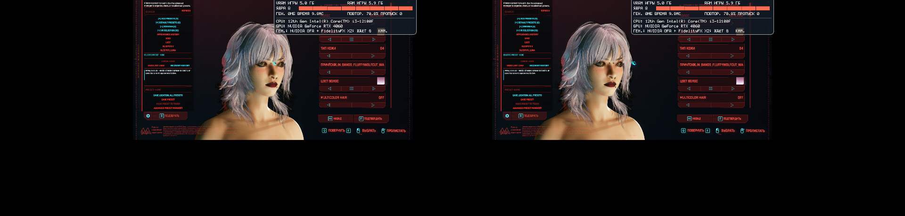

# Character-editor stereo checkpoint — 15 October 2026

The current local development build now submits both character-editor views to OpenXR. The composed left/right images were inspected in the simulator. This is a simulator checkpoint, not physical-headset acceptance or a stable release.

## Fixed defect

During the world-to-menu transition, the renderer attempted to copy a stale 1920 × 1920 world depth texture into a 1782 × 1920 eye-depth texture. D3D12 validation reported error 858. Closing the invalid command list then failed; subsequent resets returned E_INVALIDARG, preventing already-captured editor images from being submitted.

The correction omits projection-depth copies for menu quads and validates source/destination depth dimensions and sampling before recording a copy. The repeated diagnostic run had zero instances of error 858 and zero menu submit failures; both editor views were visible.

- Local source checkpoint: `7f6432690e347b3f200bf791c8cb52183494a059`.
- Tested DLL SHA-256: `ACA525CCB0BC03D79059E6196618B339513119B4FA2B3363C7E09D21402C76BF`.
- [Focused code change](editor-depth-fix.patch). This patch records the change against local parent `59a0b39`; it depends on the preceding local stereo implementation and is not an installer or a patch for the inherited upstream checkout.
- Local development state also retained three earlier frame-generation changes outside that checkpoint; the hash above identifies the actual tested binary.

## Diagnostic tooling

A reusable scenario selects Editor, Inventory, or the last saved game before launching the per-process OpenXR simulator. Menu navigation uses game APIs. A guarded Windows input step handles the post-load confirmation when needed. The Editor route completed end to end without manual navigation in a subsequent run: the helper recorded one Space input, the editor reported READY, and stereo submission was confirmed. Inventory and Save targets are implemented but were not exercised end to end in that run.

## Remaining work

Physical-headset comfort and stereo acceptance, broader menu transitions, settings persistence and full-game stability remain open. Preparing a reproducible public source distribution also requires separating external SDK dependencies and local research assets. This repository still contains the upstream base, project documentation and this focused development checkpoint; it does not yet contain the complete local Astra implementation.