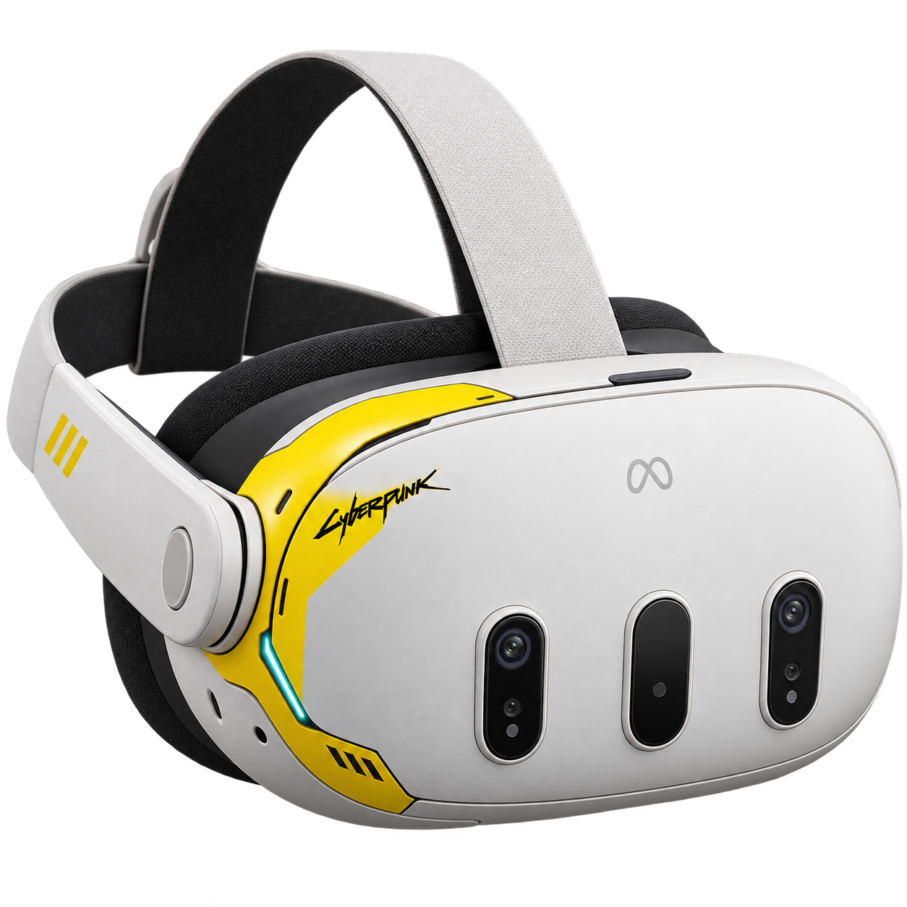

<!-- JOINT-USE-20261018-BEGIN -->

No mode is declared finished. Features, controls and architecture may change or disappear following testing; this is not a promised roadmap or complete feature list.

## VR-CENTR + Astra HD: install and use together

### Development goal

We want Cyberpunk 2077 to become a complete VR experience: from spatial menus and the character editor to a comfortable, readable HUD and interaction with the game world. The foundation is high-quality stereo, stable FPS and coherent neural rendering with frame generation. The interface should suit headsets and VR controllers. This is our development goal, not a list of finished features.

This is an unfinished experimental combination, not a finished stable VR port. Astra HD sends the game to the headset; VR-CENTR manages installation contents and profiles. Profiles were created because repeated VR, mod and library tests left mixed, nonworking file combinations. They support repeatable tests and restoring a chosen state without manually deleting several game folders, downloading the game again through Steam or reinstalling after each test. 

**No ready combined installation archive is available yet.** [Astra HD Releases](https://github.com/konstanaft-stack/Astra-HD/releases) is the future download location. The automatic Source ZIP contains source code, not an installer; a checkout alone does not restore a working installation.

Once a verified installation archive is published:

1. Install your own Cyberpunk 2077 through Steam. The public package does not include the game, paid third-party ports or personal saves.
2. Download the ready archive from Releases, extract it, run its included installer and select your game folder.
3. In VR-CENTR, first preserve a verified clean baseline and create a clean profile. Then choose a mod collection and Astra HD VR port, and apply that composition.
4. Launch through the center. Switch profiles, ports or libraries only after closing the game; save any current state you want to keep first.

The shared OptiScaler/NR/MFG package is installed once per game, not separately per profile. Back up personal saves separately. HUD, editor, motion and performance still need headset validation.


### Current experiments and development directions

- **Dual camera:** separate left/right views are the current foundation. FPS, frame generation and stability remain under development; 80 FPS is not verified.
- **Alternating eyes/AER:** the user subjectively finds the world more natural, freer and more present than with our current dual-camera output; the cause is unknown. This mode is seriously unfinished: large halos previously diminished or disappeared, then returned. That regression remains unresolved.
- **Stereo character editor:** spatial preview, headset inspection and left grip/stick camera height/zoom are being developed. Centering, UI overlap and FPS defects remain; this is not an accepted, finished Luke-like mode.

Contributions investigating a specific defect or branch are welcome through PRs. Include version, GPU, HMD/runtime and reproduction steps. Upstream attribution is preserved.

### Current prototype controls: editor camera

Hold left grip: left stick ↑↓ adjusts height (0.5 m/s), ←→ adjusts distance (0.6 m/s). Grip+left-stick click resets camera height/distance only, not global HMD recentering. Mouse: Shift+wheel height, Ctrl+wheel distance, Ctrl+middle button reset. Headset validation of these axes remains open.

OptiScaler: Insert opens its menu, F12 requests its FG toggle, and \ toggles NR after world load. These are separate from port Own FG. On the current RTX4060 setup, NR310.9.16 still returns createFeatureNotSupported.

Forks, porting our changes to other forks or bringing Cyberpunk support into a main project, and help with individual defects are welcome. We continue our own development alongside this collaboration; preserve licenses and upstream attribution.

<!-- JOINT-USE-20261018-END -->

# VR-CENTR

[](README.md) [](README.ru.md) [](README.zh-CN.md)

**In development.** VR-CENTR is a Windows desktop manager for a personally owned Steam installation of **Cyberpunk 2077**. Its current code is specific to that game. Other Steam games are ideas for future adapters; they are **not supported today**. We are publishing the source to invite review and contributions. The interface and workflow still need work.



## What the current code does

- Creates a fresh game profile from a **previously saved, verified clean baseline**. It checks local stock manifests and file hashes. It does not provide the game or create a clean baseline from missing files.
- Saves and switches complete Cyberpunk game profiles with transaction journals and recovery checks. These operations can be slow because large game files are read and copied; plan for enough free disk space. Do not interrupt a switch in progress.
- Lists installed and locally imported Cyberpunk VR-port variants, their optional components and selected NVIDIA libraries, and applies a chosen configuration with file checks and backups. An imported ZIP is a candidate, not proof of compatibility or headset quality.
- Supports a configured Mod Organizer 2 launch source and its selected profile. It detects Vortex and can isolate additional files in known Cyberpunk mod directories. It **does not** control Vortex's LevelDB profile or perform Deploy/Purge for you.
- Provides local launch checks and status. VR-port runtime behavior, frame generation, image quality and comfort still require testing in a physical headset.

## Build and run on Windows

Install the .NET 8 SDK and PowerShell 7 (`pwsh`). Clone this repository, copy `config.example.json` to `config.json`, and edit every path to match **your own** Steam game installation and your separately obtained Cyberpunk VR bundle. `config.json` is ignored by Git. The bundle must have the manifests and installer expected by the backend; it is not included here. A clean profile additionally needs a saved and verified clean baseline. MO2 and Vortex are optional local programs, configured separately when used.

```powershell
Copy-Item .\config.example.json .\config.json
dotnet restore .\VRPorts.csproj
dotnet run --project .\VRPorts.csproj
# To create a self-contained Windows build in ignored releases/:
.\Build.ps1 -Version local
```

The checked-in Quest 3 icon was generated for this project. This public source export uses a compact, independently written Avalonia theme. The private working build uses a different visual theme, so screenshots of that build may look different. No private `config.json`, saved profiles, mods, game files, port binaries or release executables are in this repository.

**Disaster recovery boundary:** cloning this repository restores the application source, build script and sample configuration. It does not restore your game license/installation, VR-port packages, mod collections, MO2/Vortex data, personal profiles, settings, saves, or the verified clean baseline. Back those up separately under their own licenses.

## Contributing

Issues and pull requests are welcome, especially for profile-switch performance and recovery, setup documentation, portable path handling, and carefully scoped game adapters. Start with a reproducible case and the affected code path. Strip personal paths, account IDs, tokens, logs containing private data, game assets and mod binaries before sharing. Keep Cyberpunk support claims tied to a tested configuration; identify simulator-only checks separately from physical-headset results. Do not add third-party source or artwork without redistribution permission and attribution.

## Attribution and licensing

The private application's earlier theme was based on NODIX-TECH's DLSS 5 MANAGER. Its copied style resources and background artwork are **not distributed** in this source export because no redistribution license for those original portions was identified. The public theme was written anew. Avalonia packages are restored from NuGet under their respective licenses. VR ports, OptiScaler, NVIDIA libraries, game files and mods remain with their authors and are not bundled. See [THIRD-PARTY.md](THIRD-PARTY.md) for the precise scope. The repository's license applies only to material its contributors have rights to publish.

## Native-base R29 first setup (center04)

Run the clean, unmodified game to its first main menu and exit BEFORE applying a port. In the center use "Сохранить чистую основу" to capture that actual clean state. Create and retain a Flat profile, then create a separate VR profile and apply Astra HD r29 there. Return by switching to the retained Flat profile; the minimal package intentionally does not enable empty-manifest flat installer fallback. Native Apply does not capture the clean baseline automatically. The first native-base distribution includes VR plus selected NVIDIA SR/RR/G. Optional OptiScaler/NR/MFG and joint NR+FG readiness remain a separate stage. No center binaries were rebuilt for center04.